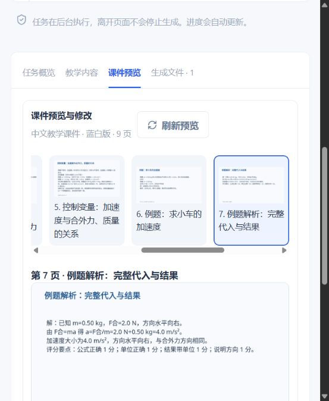

# 中文课件生成与模板

“生成教学课件”使用独立的 Presenton 引擎。课程表单、模型设置、后台任务、成果下载与
回收站仍由 Claw-ED 管理，不需要打开另一套工作台。



## 启动

先启动 Docker Desktop，等待 Engine running。在项目目录执行：

```powershell
.\.venv\Scripts\python.exe -m clawed.presenton_runtime start
.\.venv\Scripts\python.exe -m uvicorn clawed.api.server:app --host 127.0.0.1 --port 8005
```

工作台地址为 <http://localhost:8005/app>。查看或停止课件服务：

```powershell
.\.venv\Scripts\python.exe -m clawed.presenton_runtime status
.\.venv\Scripts\python.exe -m clawed.presenton_runtime stop
```

首次下载镜像较大，需预留磁盘、内存与网络时间。启动器复用现有容器，在空闲时自动
更新接口桥接文件；有任务时不重启容器。
固定镜像：`ghcr.io/presenton/presenton@sha256:18b7331753e133de2272db1b2ab0d92de75a8fc6c14e1dea81bb8a9edb8a4e95`。
实际版本为 `0.9.12-beta`，导出组件为 `1.0.51`，不跟随 latest 自动更新。

容器名为 `clawed-presenton`，仅绑定 `127.0.0.1:5002`，默认限制为 3 GB 内存、2 CPU。
模型与密钥复用工作台设置，每次操作前同步，不需要重复配置。
DeepSeek 模板视觉理解要求所选模型支持图片输入，本机使用 `deepseek-flash`。
含密钥的引擎配置只保存在本机数据目录，不进入版本库或命令行参数。

## 使用

1. 创建教学材料时填写课程信息、资料与要求，勾选教学课件。
2. 未选择 PPT 模板时使用“课堂清晰版”：中文大字号，支持说明、独立公式、对照、
   题目和三列表格；按课时和内容编排，不截断为省略号。
3. 在“教学资料 → PPT 模板”上传横版 `.pptx`。系统理解实际页面，提取用途、
   文本容量、样式、图片和可替换内容，不要求预先设置占位符。
4. 查看原页预览，勾选需要复用的版式，填写模板组织要求，点击确认保存。
5. 创建课程或重新导出时选择模板，模型结合新课程与实际模板容量安排各页。
6. 在任务详情的“课件预览”逐页检查并查看教师备注。单页修改以文字和备注为主，
   保留原版式并检查容量，创建新任务与新课件，原课件保留。
7. 下载 `课程主题_教学课件.pptx`，可在 PowerPoint 中继续编辑文字。

PPT 模板支持移入回收站、撤销与恢复；删除后不供新任务选择，历史任务保留模板版本。
任务和成果复用原有回收站。可恢复删除保留本机文件，不用于释放磁盘空间。

检索教学配图用于默认格式 Word；PPT 保留模板图片。目前未启用付费图片生成，
不会随意将未经确认的网络图片加入课件。

## 恢复与导出

- 教学方案、课件计划、远端任务编号、页面数据保存在任务输出目录。同次提交使用
  固定操作编号，网络重试先查询原任务，避免重复创建。
- Word、PPT 分别导出，PPT 失败时已生成的 Word 保留，可以恢复原任务。
- 已完成课件重新导出复用页面，不再调用模型；更换 PPT 模板需要重新编排课件。
- 取消会同时请求停止远端任务。供应商已收到的请求不能撤回；恢复复用方案和计划，
  未完成课件重新生成，不承诺逐页无损续传。
- 容器重启会把失去执行进程的 pending 任务标为中断，恢复后重新尝试。
- 预览与 PPTX 使用相同的页面渲染，包括字体和公式，并按页面内容缓存。
- 导出前压缩多余空白段落，不删除教学文字；导出后检查文本是否超出画布。
  发现越界时保留 Word 和课件页面，提示具体页码，可在预览中精简后生成新课件。

输出目录的 `ppt_state.json` 保存恢复信息。应同时备份工作台数据库、输出目录和
数据目录的 `presenton` 文件夹；单独保留 PPTX 不能恢复网页编辑状态。

## 已知边界

- 横版 PPTX，默认单份 1–60 页、50 MB，解压后最多 250 MB。范围内完整预览和提取，
  不自动裁页；超过限制时提前拒绝，提示选取代表页另存为副本。竖版明确拒绝。
- 模板限制集中在 `clawed/ppt_limits.py`。工作台校验、网页提示与引擎共用该配置，
  不再叠加上游默认 50 页裁剪。修改配置后重启工作台，并运行课件服务启动命令同步。
- 原文件页数、预览数与实际分析范围必须一致，缺页或零页会明确报错，不保存不完整模板。
  旧的截断预览会在重新提取时作废并重新读取原文件，原文件和历史模板版本仍保留。
- 复杂旧图形、部分富文本和公式对象可能触发上游转换错误，界面保留原文件并提示
  另存 PPTX 后重试，不承诺所有 PowerPoint 对象无损兼容。
- 文字可编辑；公式可能作为 SVG/图片导出，不等同于原生公式对象。默认三列表格由
  可编辑文字与形状组成，不是原生表格控件。
- 动画、视频、复杂母版和交互控件不承诺保真。生成的知识、答案、排版仍需逐页审核；
  容量不足时精简内容或换用更合适的版式。跨机器字体可能替换。

## 本机实际操作（2026-11-12）

未编写或运行测试脚本。使用真实 API、中文网页和 PowerPoint：

- 默认模板生成 12 页万有引力课件，检查题干、计算代入式、结果、中文字体及 12 页备注。
  在 PowerPoint 中编辑标题后撤销，确认文字可编辑。
- 上传现有 22 页中文课件，确认保存为“中文教学课件 · 蓝白版”，实际删除后恢复。
- `99b3be63896a` 按提取模板生成 12 页，实际取消远端生成后恢复完成。
  同时生成的两份 Word 正文与原任务一致，无英文教学指令残留。
- 首次单页修改发现数学混排导出异常，改为固定版式、纯文本/Unicode 修改和容量检查。
  `472bfe957ede` 修订页导出后完整清晰。
- 换课验收：`06128dd5a9a1` 用万有引力课件提取的版式生成牛顿第二定律 9 页课件，
  未带入原课题、原练习；两份 Word 无英文教学指令残留。发现并修复空白段落造成的越界。
- `338c553908ba` 通过网页单页修改补全例题代入式，并在 PowerPoint 中打开核对；
  `b496f8ba2f39` 再次导出该修订版，保留修改后的内容。
- `b35fd5e8d0f0` 为默认版最终 12 页课件，包含独立公式、计算过程和三列表格。
  重新导出复用原远端课件，两份 Word 与原教学方案一致。
- 任务及三个成果已实际一起移入回收站，再恢复可下载状态。验收中间版本随后移入
  回收站保留，未删除用户此前的课程。

## 修复记录

### 2026-11-14：修复长模板被静默裁页

原先工作台允许 60 页，而上游预览默认裁成前 50 页，导致一份有效的 53 页模板转换为零页。
现统一使用 `clawed/ppt_limits.py` 的限制；引擎保留范围内的原始文件，超过范围明确拒绝，
不再进入自动裁页路径。原文件、预览及提取的页数会逐步核对，旧的不完整预览重新生成。

使用原失败记录 `BIT` 直接重新提取并保存：原件 53 页、预览 53 页、提取 53 页、保留版式
53 页，状态为可用。引擎接收文件与原上传文件 SHA256 一致，检查了第 51、52、53 页预览。
实际完成前端构建和网页操作，未编写或运行测试脚本。


## 上游

[Presenton](https://github.com/presenton/presenton) 使用
[Apache-2.0 许可证](https://github.com/presenton/presenton/blob/main/LICENSE)，以独立容器运行，
未将整个上游代码复制进本项目。`clawed/presenton_bridge.py` 提供幂等提交、取消、
模板快照、预览、受约束的单页修改。升级固定镜像前应重新验证真实 PPTX。
