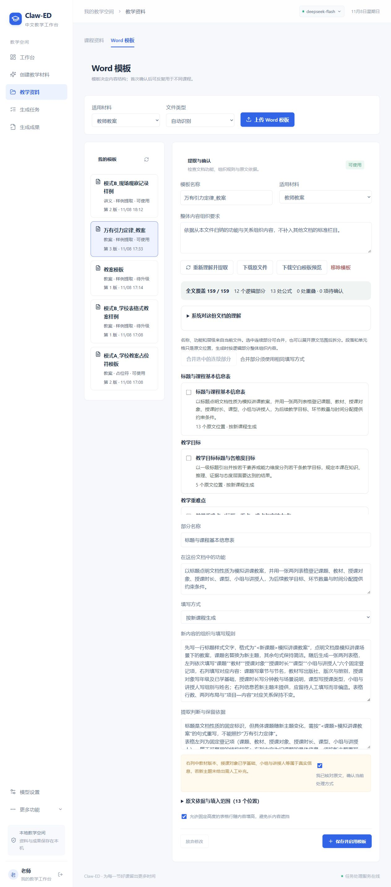

# Word 模板：先确定结构，再生成内容

## 使用入口

在“教学资料”中切换“课程资料 / Word 模板”。课程资料提供知识内容；模板规定
栏目、填写要求和版式，两者分别选择。上传模板不会把旧教案正文加入课程资料。
已上传到课程资料的 DOCX 可以点击“存为 Word 模板”，原资料保留。

模板暂支持 DOCX，每份最多 20 MB。旧 DOC 请先另存为 DOCX。

## 模式 A：占位符模板

在 Word 段落或表格中使用 `{{ topic }}`、`{{ knowledge_objectives }}` 等占位符。
变量不限于 MasterContent 的字段：系统按模板中的栏目与填写要求动态生成内容结构。
英文变量仅用于定位，网页显示中文栏目名称。支持普通文本、点分字段及单层循环。

系统先理解全文，再结合上下文解释作者设置的占位符，归纳文档用途、读者和组织关系。
请检查各部分的功能与填写规则，再点击“保存并启用模板”。未知实际信息可设为人工填写、
留空或固定内容；模型生成时使用本次任务的课程信息。不能编造未提供的真实信息。

示例：`examples/word_templates/模式A_学校教案占位符模板.docx`。包含知识目标、能力目标、
跨概念联系、重点难点，以及五列教学过程。教学过程按以下方式重复表格行：

1. 独立的开始控制行包含 ``。
2. 中间样式行的各单元格使用 `{{ step.stage }}`、`{{ step.time }}`、
   `{{ step.teacher_activity }}`、`{{ step.student_activity }}`、`{{ step.design_intent }}`。
3. 独立的结束控制行包含 ``。

循环会保留中间样式行的格式并展开。复杂富文本、子文档、函数调用、任意计算、
嵌套循环和动态合并暂不作为首版支持范围；遇到不支持语法会明确提示。

## 模式 B：普通教案样例

上传已有教案、记录表或其他 DOCX，点击“理解全文并提取模板”。后台依次阅读完整文档、
归纳实际用途与组织关系、提取功能范围、复核粒度与跨主题可复用性。不预设“教学目标”
等标准栏目，不将原文件映射为 MasterContent。长文件分片仅用于控制资源消耗，之后会
综合形成全篇理解；任何一段未被处理、范围重复或输出不完整，都不能启用模板。

网页先显示全文用途、读者、组织方式与部分之间的关系，再按文档自身的层级显示逻辑部分。
标题、说明、正文、公式和表格可共同组成一个部分。用户可修改功能与规则、合并连续部分、
按原文位置拆分、指定少量固定标签、选择生成/保留/留空/人工填写/固定文字。不确定判断
单独提示，须核对确认。未分配位置是错误，不再默认保留旧正文。

生成时按这些功能与关系逐部分组织新内容，各原文位置只是版式承载点。连续段落可整体
替换为数量不同的新段落；表格按原单元格填入协同内容，支持嵌套表格中的常规正文。
原生公式参与理解，新公式以可编辑的 Word 数学对象输出。普通合并单元格保持原结构，
纵向合并延续格不会重复提取。按任意数量重复表格行仍建议采用模式 A 的显式循环。

旧版逐位置提取的样例会提示升级，重新理解并保存后才能用于新任务；历史任务的版本
仍可重新导出。提取为后台任务，网页显示阶段进度，可离开后返回查看。

示例：`examples/word_templates/模式B_学校表格式教案样例.docx`。样例中的浮力正文、
旧班级和课后反思在提取确认后可以被新课程替换或清空，栏目与表格保留。

## 生成、预览和版本

创建任务时，教师教案和学生讲义分别选择模板；未选择则继续使用默认格式。
仅生成模板 Word 时，不要求先生成 MasterContent；模型直接按模板栏目设计正文。
同一任务还需要默认讲义或 PPT 时，以已生成的模板教学方案为依据生成兼容教学方案，
继续导出其他产物。学生模板的生成要求不包含教师讲稿与参考答案；模板中的固定文字
仍由教师检查。

保存模板会建立独立版本，并先执行空白预览渲染。任务引用当时版本与文件摘要；修改、
删除模板不改变历史任务的版本文件。删除后可立即撤销，也可从“Word 模板 → 回收站”恢复。

任务详情可“重新导出文件”，选择沿用原版本、使用当前模板版本或默认格式。同一内容
规则下复用已保存的生成结果；改动栏目或填写要求时，会按新要求重新组织内容。

网页目前提供的是结构预览；真实排版请下载空白 Word 预览和实际生成文件检查。
默认允许固定高度的表格行随内容增高，以避免正文被遮挡；可按学校要求关闭。
模板原有字体、边框、表格、页眉页脚与图片保留，新增内容可能改变分页和总页数。
独立浮动文本框可按段落提取，正文与文本框混排、修订、脚注/尾注及外部嵌入正文会明确
提示先整理，避免静默漏读。图像与嵌入对象只读取结构和替代说明，须人工确认实际作用；
不能保证恢复图中细节。新版段落继承原文样式，复杂公式采用线性数学表达写入原生对象，
不能保证与原复杂公式的二维排版完全一致。检索配图功能用于默认格式产物。

模板与各版本保存在 `~/.eduagent/workbench/templates/`；任务另存
`template_content.json`，包含模板版本、动态生成字段和内容，以便恢复与重新导出。

## 文档驱动提取升级：实际操作记录

- 用户长篇教案：原先 77 个细字段、仅处理至文档中部；新版完整覆盖 159 个位置，
  识别全部 13 处原生公式，复核后形成 12 个逻辑部分。已保存第 3 版，旧版本文件保留。
  空白预览中未发现“万有引力”“月地检验”“卡文迪许”等旧主题文字。
- 用该模板跨学科生成 40 分钟《光合作用》教案（`d2029ca2d6c5`）：约 9,700 字，
  3 张原有表格、1 处新原生公式，完整生成后半部分；上述旧知识与“牛顿大炮”计数为零。
  实际操作中修复了长部分 60 内容块上限、模型自定义功能标签、重复标题及重复表格。
- 网页重新导出为 `30e5c60c343c`，复用全部已保存内容，无新增模型生成事件；
  网页下载 `光合作用_教师教案.docx` 成功，连续重复段落为零。
- 新增“现场观察记录”示例，按该文件自身的 4 部分归纳，没有新增标准教案栏目。
  任务 `94ccb66b5e94` 实际生成《植物叶片颜色观察》讲义；网页完成拆分、合并、保存，
  全部 12 个位置始终被覆盖，生成时仍使用任务保存的原版本。
- 占位符模式重新理解后保存第 2 版，任务 `13f7738ecb9a` 生成《声音的产生与传播》教案；
  主题与教学对象正常填写，循环表格正常展开。

按用户要求没有编写或运行测试。完成前端生产构建、真实模型调用、网页编辑、保存、
生成、恢复、重新导出和下载。尚未逐页核对 Word/WPS 的视觉分页，也未核验生成的参考文献。
模型对文档功能的归纳仍需用户确认；内容块的生成数量不要求与原文段落数量相同。

## 前一版接入的实际操作记录

- 网页上传并保存占位符模板，生成任务 `3851fc227a4e`：跨概念联系按要求生成，
  教学过程表展开为五个环节，下载成功；没有先生成固定 MasterContent。
- 对普通样例真实调用 DeepSeek 提取并确认，切换模板生成 `0c80a91121ba`：保留两张
  原表，旧浮力内容未进入新教案，原班级与课后反思留空。
- 从资料库的“教案模板.docx”导入真实学校模板，提取三维目标、方法、准备、板书等
  栏目并确认；任务 `935cadeb9be7` 生成学校版教案、默认学生讲义与 PPT。
- 沿用该版本重新导出任务 `977256c731f6`：直接复用模板内容与已保存的兼容教学方案，
  完成三份文件导出并实际下载教案，没有重新调用模型生成教学内容。

按要求未编写或运行自动化测试，进行了前端构建与真实上传、提取、生成、下载操作。
未完成所有 Office 版本的逐页视觉核对，实际版式仍需教师下载检查。

## 第三方组件

Word 模板渲染使用 docxtpl 0.20.x，其上游声明许可证为 LGPL-2.1-only；项目保留
独立依赖及对应许可说明，未把上游代码改写为本项目许可。

- 上游：https://github.com/elapouya/python-docx-template
- 文档：https://docxtpl.readthedocs.io/en/latest/
