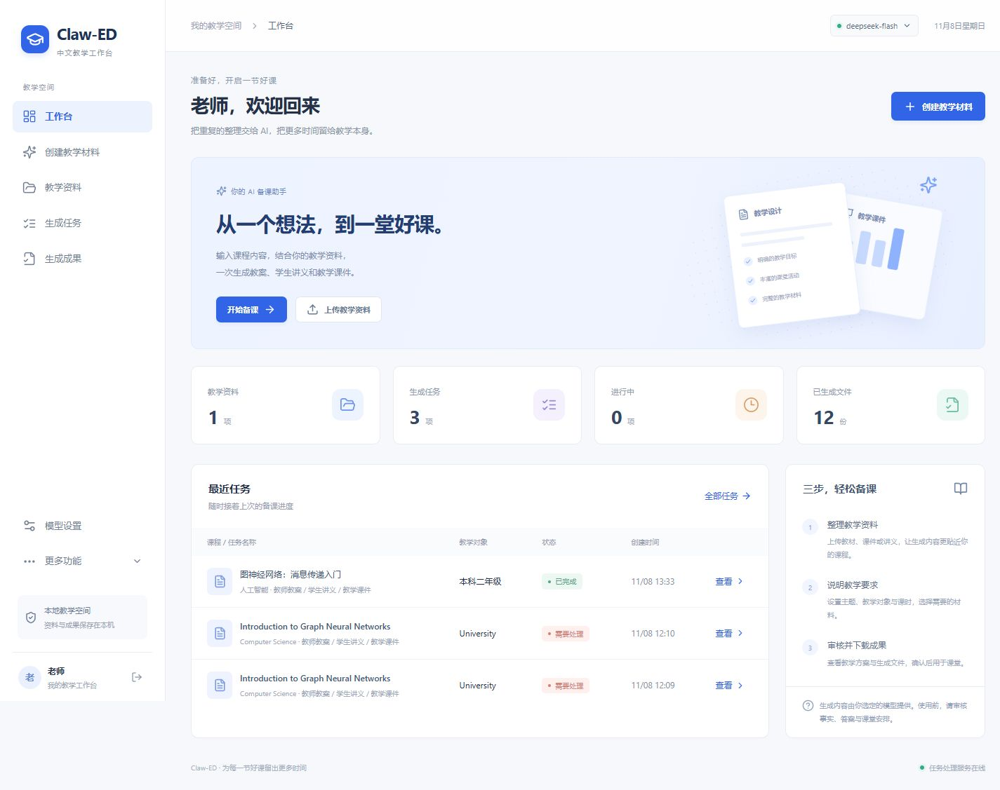

# 中文教学工作台

工作台复用 Claw-ED 的模型客户端、MasterContent 教学内容结构、任务队列和
DOCX/PPTX 编译器。页面包括工作台、创建教学材料、教学资料、生成任务、
生成成果和模型设置。不包含 Office 模板上传功能。



## 启动

在项目根目录的 PowerShell 中执行：

```powershell
.\.venv\Scripts\clawed.exe serve --host 127.0.0.1 --port 8005
```

打开 http://localhost:8005 。首页进入中文界面 `/app`，原版页面与 API 继续保留。
初次登录使用本地访问令牌，与 DeepSeek API Key 不同：

```powershell
Get-Content "$env:USERPROFILE\.eduagent\api_token"
```

若设置了 `EDUAGENT_DATA_DIR`，令牌位于该目录。网页通过 HttpOnly 会话 Cookie
访问 API，不把管理令牌保存到前端本地存储。

服务默认自动启动一个后台队列处理器；SQLite 原子领取机制允许与 CLI Worker
共存。需要自行管理 Worker 时，启动服务前设置 `CLAWED_WEB_WORKER=0`。
任务处理状态根据真实心跳显示，异常退出的任务仍需手动检查中断、恢复。

## 使用

1. 在模型设置中确认供应商和模型；密钥留空时保留已配置值。
2. 上传 PDF、DOCX、PPTX、TXT 或 Markdown 资料；每份最多 50 MB，一次最多 20 份。
3. 查看文字解析结果；扫描 PDF 需先 OCR。资料原文件和提取文字保存在本机。
4. 创建任务，填写课程主题、学科、教学对象、15–240 分钟课时和教学要求。
5. 选择本次使用的资料，以及教案、学生讲义、课件中的一种或多种产物。
6. 后台生成中文教学方案并保存，再分别导出所选文件。可查看教学内容与下载产物。

课程信息、资料选择、教学要求与输出选项现在放在同一页，右侧展示实时摘要。
输入框不显示示例内容，正文与表单采用 16px 字号，辅助文字至少 14px。

中文工作台使用专门的中文导出器：课件保留完整概念、讲解、题干、计算过程，
内容较长时分页，不再按字数截断并加省略号。教师讲稿和参考答案放在课件备注中；
教师教案包含参考答案，学生讲义保留作答区。公式、单位和必要的专业名词保留。
文件名采用“课程主题_教师教案.docx”“课程主题_学生讲义.docx”及
“课程主题_教学课件.pptx”；自动处理 Windows 文件名禁用字符。

旧课程可在任务详情点击“重新导出文件”，复用已保存的教学方案生成新版文件。
这会创建关联原任务的新任务，保留旧文件；文字方案不再次调用模型。
如开启配图，图片检索与审核仍可能调用外部服务。

## 删除与恢复

- 在任务列表或详情删除记录，默认保留生成成果，也可勾选同时删除成果。
- 在生成成果页面单独删除一组成果，保留任务记录。
- 删除内容进入“生成成果 → 回收站”，可恢复记录与成果。
- 正在排队或生成的任务须先取消，等待停止后才能删除。

当前采用可恢复删除，文件仍保存在本机，不用于释放磁盘空间。
成果列表独立于任务列表读取，删除记录不会导致保留成果消失，也不再受最近 20 条任务限制。

资料按任务显式选择，不从其他课程资料中隐式取用。资料文本预算共 60,000
字符，单份最多 20,000 字符；多份资料均分预算。超出部分会在任务中提示。
原文件不截断。完整教学方案存为任务输出目录中的 `master.json`，引用资料
另存 `资料来源.json`。内容检查并不代表教学审核通过，请教师使用前复核。

任务生成内容有缓存，恢复匹配任务可以复用已保存的教学内容，继续导出。
生成失败和部分导出失败会明确显示，不用演示结果代替真实调用。

## 开发前端

已包含构建后的界面，正常运行只需要 Python。修改前端后：

```powershell
cd frontend
npm ci
npm run build
```

构建输出位于 `clawed/api/workbench_dist`。重启 Python 服务并刷新页面即可。
开发热更新可使用 `npm run dev`，Vite 将 `/api` 代理到本机 8005 服务。

资料和阶段事件分别保存到 `~/.eduagent/workbench/` 与已有任务账本中，
`EDUAGENT_DATA_DIR` 可改变数据目录。原版学生、统计和教学面板从“更多功能”进入。
